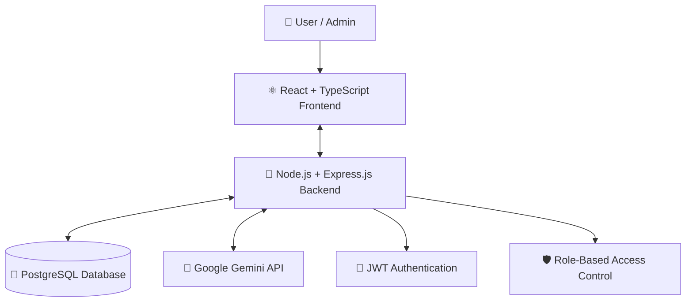

# 🔎 Lost & Found Management System

### Lost something? Found something? Let's bring it back to its owner. 💙

A full-stack web application that provides a centralized platform for reporting lost belongings, registering found items, discovering relevant listings, and submitting claims — enhanced with **AI-powered search using the Google Gemini API**.

  
  
  
  
  
  
  

---

## 📌 Table of Contents

- [🌟 About the Project](#-about-the-project)
- [🎯 Problem Statement](#-problem-statement)
- [✨ Key Features](#-key-features)
- [👥 User Roles](#-user-roles)
- [🛠️ Tech Stack](#️-tech-stack)
- [🏗️ System Architecture](#️-system-architecture)
- [🗄️ Database Design](#️-database-design)
- [🔌 API Overview](#-api-overview)
- [⚙️ Getting Started](#️-getting-started)
- [🔐 Environment Configuration](#-environment-configuration)
- [🧪 Testing](#-testing)
- [🗺️ Future Scope](#️-future-scope)
- [🤝 Contributors](#-contributors)

---

## 🌟 About the Project

The **Lost & Found Management System** is designed to make recovering lost belongings easier by bringing lost-item reports, found-item listings, search functionality, and claim requests together in one place.

Instead of relying on scattered messages or disconnected platforms, users can report items, explore available listings, and submit claims through a centralized web application.

The project also incorporates an **AI-powered search feature** using the Google Gemini API, allowing users to search for relevant items using natural-language descriptions. A keyword-based fallback is also specified for situations where AI search is unavailable.

### 💡 Our Mission

> Make lost belongings easier to find, make found belongings easier to return, and connect people through a smarter recovery process.

## 🎯 Problem Statement

Losing personal belongings can be stressful, and finding the rightful owner of an item can be equally challenging. Information about lost and found belongings is often distributed across different platforms, making it difficult to locate relevant information.

This project aims to address that problem through a centralized system where users can:

- Report lost belongings.
- Register items they have found.
- Search and filter relevant listings.
- Submit claims for found items.
- Track their claims.
- Manage their personal item records.

## ✨ Key Features

### 🔍 1. Lost & Found Item Management

- Report lost belongings with relevant item details.
- Register found items.
- Browse lost and found listings.
- View individual item details.
- Manage personal item records where permitted.

### 🤖 2. AI-Powered Smart Search

- Search for relevant items using natural-language descriptions.
- Integrate the Google Gemini API for AI-powered search.
- Provide keyword-based search as a fallback when supported and configured.
- Help users discover potentially relevant listings.

### 🔐 3. Authentication & Security

- User registration and login.
- JWT-based authentication.
- Password hashing using bcrypt.
- Password, email, and username management.
- Role-based access control for protected features.

### 📦 4. Claim Management

- Submit claims for found items.
- View personal claim history.
- Track claim status.
- Allow administrators to review claims and update their status.

### 👤 5. User Dashboard

- Manage personal lost-item reports.
- Manage found-item records.
- View submitted claims.
- Access account-management features.

### 🛡️ 6. Admin Dashboard

- Manage user accounts and roles.
- Block or unblock users.
- Manage item categories.
- Review and process claims.
- Moderate item listings.
- View available dashboard statistics and recent activity.

### 🗂️ 7. Category Management

- Organize listings into item categories.
- Retrieve available categories.
- Support administrative category management.

### 📱 8. Responsive Interface

- React and TypeScript-based frontend.
- Tailwind CSS for responsive styling.
- Redux Toolkit for shared application state.
- User-oriented pages, forms, listings, and dashboards.

---

## 👥 User Roles

| Feature | User | Admin |
|---|:---:|:---:|
| Register and log in | ✅ | ✅ |
| Report lost items | ✅ | According to permissions |
| Register found items | ✅ | According to permissions |
| Search and browse listings | ✅ | ✅ |
| Submit and track claims | ✅ | Review and manage claims |
| Manage personal records | ✅ | — |
| Manage user accounts and roles | ❌ | ✅ |
| Manage item categories | ❌ | ✅ |
| Moderate listings | ❌ | ✅ |
| View administrative statistics | ❌ | ✅ |

*Exact access permissions depend on the application's authorization rules.*

---

## 🛠️ Tech Stack

| Technology | Purpose |
|---|---|
| React | Interactive frontend |
| TypeScript | Type-safe frontend and backend development |
| Tailwind CSS | Responsive UI styling |
| Redux Toolkit | Shared state management |
| Node.js | Backend runtime |
| Express.js | REST API development |
| PostgreSQL | Relational database |
| Prisma ORM | Database access and schema management |
| JWT | Token-based authentication |
| bcrypt | Password hashing |
| Google Gemini API | AI-powered item search |

---

## 🏗️ System Architecture

The application follows a three-layer architecture connecting the frontend, backend, database, and AI search service.

### 🔄 Application Workflow

1. A user interacts with the frontend.
2. The frontend sends a request to the backend API.
3. The backend validates the request and checks permissions.
4. Prisma ORM communicates with PostgreSQL when database access is required.
5. For AI-powered searches, the backend communicates with the Google Gemini API.
6. The backend returns a response, and the frontend displays the result.

---

## 🗄️ Database Design

The project documentation identifies five main database models:

| Model | Description |
|---|---|
| `User` | Stores user account information and roles |
| `ItemCategory` | Organizes lost and found items into categories |
| `LostItem` | Stores lost-item reports |
| `FoundItem` | Stores found-item records |
| `Claim` | Stores claim requests and their status |

The application uses **PostgreSQL with Prisma ORM** for database management. The exact relationships, field names, and constraints should be verified against the project's Prisma schema.

---

## 🔌 API Overview

The backend exposes REST API endpoints for the application's main operations.

| Module | Example Endpoints |
|---|---|
| Authentication | `POST /api/register`, `POST /api/login` |
| User Management | `GET /api/users`, `PUT /api/change-role/:id` |
| Item Categories | `GET /api/item-categories`, `POST /api
